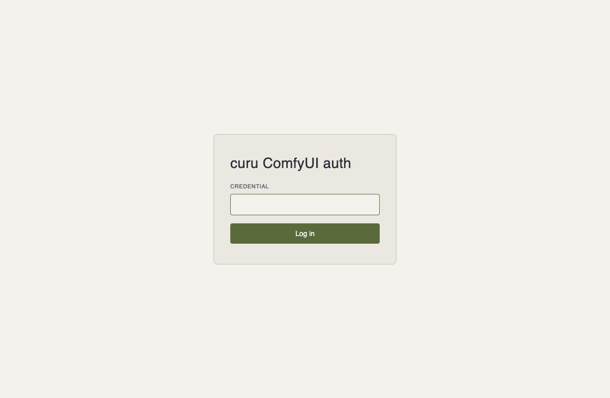
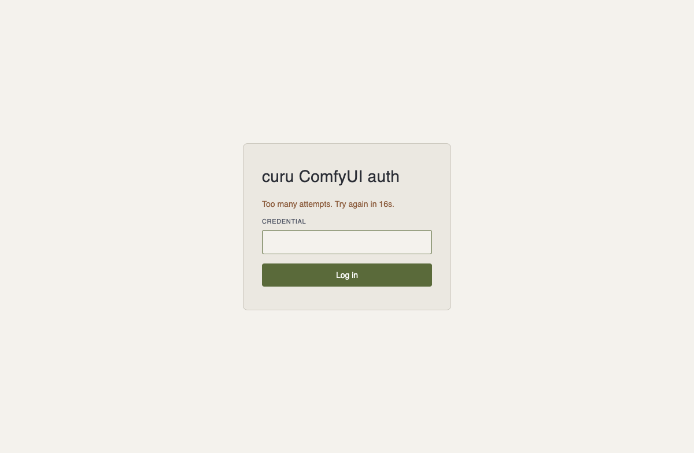

# comfyui_curu_auth

## What is this

comfyui_curu_auth is a ComfyUI custom node that puts a credential in front of your whole ComfyUI server. It covers each route, also the `/ws` connection that progress updates use. It needs no accounts, no configuration file and no external service. Install it and restart ComfyUI, and it prints a credential to the console. It is for a person who runs ComfyUI on a home computer or on a rented GPU.



## What you can do

| Task | Command or setting | Section |
|---|---|---|
| Call ComfyUI from a program | `Authorization: Bearer <credential>` | [Call ComfyUI from a program](#call-comfyui-from-a-program) |
| Log in from a browser | Open `/curu-auth/login` | [Log in from a browser](#log-in-from-a-browser) |
| Keep the same credential | `COMFYUI_CURU_AUTH_TOKEN` | [Keep the same credential after a restart](#keep-the-same-credential-after-a-restart) |
| Let a program send an access token | `COMFYUI_CURU_AUTH_OIDC_AUDIENCE` | [Let a program call ComfyUI with an access token](#let-a-program-call-comfyui-with-an-access-token) |
| Log in with your identity provider | The four connection settings and an allowlist | [Log in through your identity provider](#log-in-through-your-identity-provider) |
| Log in with your identity provider at more than one address | A list in `COMFYUI_CURU_AUTH_OIDC_REDIRECT_URI` | [Log in through your identity provider at more than one address](#log-in-through-your-identity-provider-at-more-than-one-address) |
| Choose HTTPS or plain HTTP | `X-Forwarded-Proto: https` at your proxy | [Use HTTPS or plain HTTP](#use-https-or-plain-http) |
| Understand a 429 | Wait for `Retry-After` | [Recover from repeated failures](#recover-from-repeated-failures) |
| Block attackers at the firewall | `contrib/fail2ban`, `contrib/crowdsec` | [Block repeat offenders at the firewall](#block-repeat-offenders-at-the-firewall) |

## Install

```bash
cd /path/to/ComfyUI/custom_nodes
git clone https://github.com/darth-veitcher/comfyui_curu_auth
```

## Quickstart

1. Restart ComfyUI. The console shows the credential:

   ```text
   comfyui-curu-auth gate active. Credential:
     Yx3fQvR8...
   ```

2. Open ComfyUI in your browser. The gate sends you to its login page.
3. Paste the credential, and select "Log in". ComfyUI opens.

You cannot get the credential over the network. It goes only to the console. The gate does this on purpose: an exchange of credentials over the network is a new point of attack.

## Call ComfyUI from a program

Send the credential in the `Authorization` header of each request, also on the `/ws` handshake:

```bash
curl -H "Authorization: Bearer $COMFYUI_CURU_AUTH_TOKEN" http://127.0.0.1:8188/queue
```

A correct credential gives the normal answer of ComfyUI. A missing or wrong credential gives HTTP 401 with `{"detail": "missing or invalid credential"}`.

## Log in from a browser

Open `/curu-auth/login`, or any page of ComfyUI, and paste the credential. The gate then sets a session cookie for 30 days. Its name is `curu_auth_<port>`, for example `curu_auth_8188`. The cookie is `HttpOnly` and `SameSite=Strict`. It holds a separate session token, so the browser never sends the credential again.

The port in the name is the port that ComfyUI listens on. A browser sends the cookies of a host to each port of that host. So with this name, each ComfyUI instance on one host keeps its own login. For example, you can stay logged in to `http://192.168.1.117:8188` and `http://192.168.1.117:8189` at the same time. The gate reads only its own cookie, and it never expires the cookie of another instance. The port does not come from the `Host` header, because the client writes that header. Behind a reverse proxy, the name holds the port of ComfyUI, not the port of the proxy. If the gate cannot read the port, for example on a Unix socket, the name is `curu_auth_0`.

The gate keeps the sessions in memory, so a restart of ComfyUI ends each session. An open ComfyUI tab then goes to the login page by itself. This occurs within 5 seconds after ComfyUI is ready again. Log in, and the tab shows ComfyUI again. ComfyUI keeps your open workflow in the browser storage, so you do not lose it. The ComfyUI setting "Persist workflow state and restore on page (re)load" does this. It is on by default.

While ComfyUI is down, the tab stays on its page. An HTTP 401 from ComfyUI or from another node does not move the tab.

Log in 1 second or more after the tab goes to the login page. Before that, the login page can ask you to wait 1 second. The old cookie of the tab counted as one wrong credential.

## Keep the same credential after a restart

The gate keeps the active credential in `user/default/comfyui_curu_auth/credential` under ComfyUI. It uses that file at each restart. So the credential stays the same, also after a reboot from ComfyUI-Manager.

To choose the credential yourself, set `COMFYUI_CURU_AUTH_TOKEN`:

```bash
export COMFYUI_CURU_AUTH_TOKEN="$(python3 -c 'import secrets; print(secrets.token_urlsafe(32))')"
```

Set it where you start ComfyUI. Examples are a shell `export`, the `Environment=` of a systemd unit, and the `environment:` of a `docker-compose.yml`. When you set the variable, the gate uses it and not the file. The gate also writes its value to the file.

A reboot from ComfyUI-Manager keeps the old environment of the process. So the gate does not get a variable that you set after the first start. It uses the credential in the file. To use a new variable, stop ComfyUI and start it again.

## Log in through your identity provider

An identity provider is a service that logs people in, for example rauthy, Authentik, Keycloak or Google. The gate can use one with OpenID Connect (OIDC). The credential and the Bearer header keep working.

1. Register a confidential client at the identity provider. Use PKCE `S256` and an asymmetric signing key, for example RS256 or EdDSA.
2. Register the redirect URI `https://<your ComfyUI host>/curu-auth/oidc/callback`.
3. Copy the `issuer` value exactly from `<issuer>/.well-known/openid-configuration`. Keep a `/` at the end only if the document has one.
4. Set the four connection settings:

   ```bash
   export COMFYUI_CURU_AUTH_OIDC_ISSUER_URL="https://idp.example.com/application/o/comfyui/"
   export COMFYUI_CURU_AUTH_OIDC_CLIENT_ID="comfyui-curu-auth"
   export COMFYUI_CURU_AUTH_OIDC_CLIENT_SECRET="<client secret>"
   export COMFYUI_CURU_AUTH_OIDC_REDIRECT_URI="https://comfyui.example.com/curu-auth/oidc/callback"
   ```

5. Set who can log in, for example:

   ```bash
   export COMFYUI_CURU_AUTH_OIDC_ALLOWED_SUBJECTS="<sub of each person>"
   ```

6. Restart ComfyUI. The login page now has "Log in with your identity provider".

A successful login gives the same session cookie as the credential form. The gate then shows a short page, "Signed in", which opens ComfyUI. After a login on another site, the browser does not send a `SameSite=Strict` cookie with a redirect from the callback. It sends the cookie when a page on the ComfyUI site starts the next request. [Connect an identity provider](docs/oidc-providers.md) gives the steps for rauthy, Authentik, Keycloak, Auth0, Okta, Microsoft Entra ID, Google and Authelia.

| Setting | Meaning | Default |
|---|---|---|
| `COMFYUI_CURU_AUTH_OIDC_ISSUER_URL` | The issuer, exactly as the discovery document gives it. | none |
| `COMFYUI_CURU_AUTH_OIDC_CLIENT_ID` | The client id at the provider. | none |
| `COMFYUI_CURU_AUTH_OIDC_CLIENT_SECRET` | The client secret at the provider. | none |
| `COMFYUI_CURU_AUTH_OIDC_REDIRECT_URI` | The callback URL that the provider sends the browser to. For more than one address, give a list with a comma or a space between the URIs. | none |
| `COMFYUI_CURU_AUTH_OIDC_ALLOWED_SUBJECTS` | The `sub` values that can log in, with a comma or a space between them. | empty |
| `COMFYUI_CURU_AUTH_OIDC_ALLOWED_EMAILS` | The emails that can log in, with a comma or a space between them. An email matches only when `email_verified` is true. Capital letters do not matter. | empty |
| `COMFYUI_CURU_AUTH_OIDC_ALLOWED_DOMAIN` | One Google Workspace domain, compared with the `hd` claim. | empty |
| `COMFYUI_CURU_AUTH_OIDC_ALLOW_ANY_USER` | `true` lets each person that the provider accepts log in. | `false` |
| `COMFYUI_CURU_AUTH_OIDC_SCOPES` | The scopes of the login, with a space or a comma between them. The gate always adds `openid`. | `openid profile email` |

The text below omits the prefix `COMFYUI_CURU_AUTH_OIDC_` of each setting.

The OIDC login stays off until you set the four connection settings. If one of them is missing, the gate starts with no OIDC login.

The OIDC login also stays off, with a message in the console, in three cases:

- You set no allowlist. The message contains `OIDC login is off: set`. Set an allowlist, or `ALLOW_ANY_USER=true` when the identity provider already limits who can log in.
- The issuer uses plain `http` on a host that is not loopback. Use `https`.
- A redirect URI is not an `http` or `https` URL, or its path does not end in `/curu-auth/oidc/callback`. The message contains `each entry of`.

Never set `ALLOW_ANY_USER=true` for Google, because each Google account can log in there.

When the discovery document names another issuer, or an endpoint uses plain `http` off loopback, the login stops at its start. The browser gets HTTP 503, and the log shows `OIDC login unavailable:` with the reason. That line is not an `authentication failure` line, so fail2ban and crowdsec do not read it.

The callback refuses a login when one of these is true:

- The ID token uses `none` or an HMAC algorithm such as HS256.
- The ID token has no `exp` or no `iat`, or it expired more than 60 seconds ago.
- The person is not on the allowlist.

A refused callback gives HTTP 401 and counts as a failed attempt.

## Log in through your identity provider at more than one address

Do this when people open the same ComfyUI at more than one address. For example, they use a LAN address at home and a name behind a reverse proxy from outside. With one redirect URI, the provider always sends the browser back to that one address. A login from the other address then fails.

1. Register one redirect URI for each address on the client at the identity provider.
2. Give all of them in one setting, with a comma or a space between them:

   ```bash
   export COMFYUI_CURU_AUTH_OIDC_REDIRECT_URI="http://192.168.1.117:8188/curu-auth/oidc/callback,https://comfyui.example.com/curu-auth/oidc/callback"
   ```

3. Restart ComfyUI.
4. Log in from each address. Each login must come back to the address where it started.

The gate compares the address that the browser opened with each URI in the list. It compares the scheme, the host and the port. The gate reads the scheme from `X-Forwarded-Proto` or `Forwarded`, and else from the connection. It reads the host from `X-Forwarded-Host` or `Forwarded`, and else from `Host`. If no URI matches, the gate uses the first URI.

Your proxy must send the scheme and the host of the browser. Traefik and Caddy do this. In nginx, add `proxy_set_header Host $http_host;` and `proxy_set_header X-Forwarded-Proto $scheme;`. [Use HTTPS or plain HTTP](#use-https-or-plain-http) tells you how to check the scheme.

A client can change these headers. It can only select another URI from your list, never a URI of its own. The identity provider also refuses each URI that is not registered on the client.

## Let a program call ComfyUI with an access token

A program can send a short-lived access token of your identity provider in place of the credential. For example, comfy-mcp, a program that calls ComfyUI for an AI assistant, gets such a token with the `client_credentials` grant. The credential keeps working.

1. Register a confidential client for the program at the identity provider, with the `client_credentials` grant.
2. Choose the audience: the value that the `aud` claim of each token must hold.
3. Set the issuer and the audience:

   ```bash
   export COMFYUI_CURU_AUTH_OIDC_ISSUER_URL="https://idp.example.com/auth/v1/"
   export COMFYUI_CURU_AUTH_OIDC_AUDIENCE="https://comfyui.example.com"
   ```

4. Restart ComfyUI.
5. Check the console for `OIDC access tokens accepted on the Bearer path`.

| Setting | Meaning | Default |
|---|---|---|
| `COMFYUI_CURU_AUTH_OIDC_ISSUER_URL` | The issuer, the same setting as for the browser login. | none |
| `COMFYUI_CURU_AUTH_OIDC_AUDIENCE` | The value that `aud` must hold. It turns the access tokens on. | none |
| `COMFYUI_CURU_AUTH_OIDC_REQUIRED_SCOPES` | Scopes that each token must hold, with a comma or a space between them. | empty |

The access tokens need only the issuer and the audience, not the client settings or the allowlist of the browser login. An audience with no issuer, or required scopes with no audience, is a setup error. An issuer with plain `http` on a host that is not loopback is also a setup error. The console then shows `OIDC access tokens are off:`, and the gate stays on.

The gate accepts a token only when each of these is true:

- The token is a JWT, signed with RS256, RS384, RS512, PS256, ES256 or EdDSA by a key of the issuer.
- The token has `iss`, `aud`, `exp` and `iat`. `iss` is the issuer, and `aud` holds the audience.
- The time now is before `exp`. The gate gives no extra time. `iat` and `nbf` are not more than 60 seconds in the future.
- The token lives 1 hour or less, from `iat` to `exp`.
- The `typ` is `at+jwt` or `application/at+jwt`, in capital or small letters. A token of the type `JWT`, or with no `typ`, also needs a client id (`azp`, `client_id` or `cid`) and a scope. This rule refuses an ID token. The gate refuses each other `typ`.
- The token holds each required scope, in `scope` or `scp`.

The same check applies to the `/ws` handshake. A refused token gets HTTP 401 and counts as one failure, also during a wait. A valid token passes also during a wait, because nobody can guess one. So the next request of comfy-mcp, with a new token, passes.

When the gate has no keys of the identity provider, because it could not read them one time, a token gets HTTP 503. When a later read fails, the gate keeps the old keys. A 503 is not a failure of the caller: it does not count, and the log line is not an `authentication failure` line.

The gate keeps the keys of the issuer in memory. It reads them again for an unknown key, at most one time in 60 seconds. It also reads them again when they are 1 hour old, so a key that the identity provider removed stops working. [Connect an identity provider](docs/oidc-providers.md#let-programs-send-access-tokens) says which providers can give such tokens.

## Use HTTPS or plain HTTP

The session cookie is `Secure` when your browser reached ComfyUI over HTTPS. The gate knows this in two cases:

- ComfyUI serves TLS itself, with `--tls-keyfile` and `--tls-certfile`.
- A reverse proxy ends TLS and sends `X-Forwarded-Proto: https` or `Forwarded: proto=https`. The proxy of RunPod does this.

On plain HTTP, for example `http://<lan-address>:8188`, the cookie has no `Secure`. A browser does not keep a `Secure` cookie from a plain HTTP page, except on localhost. `HttpOnly`, `SameSite=Strict` and the 30 days do not change.

Plain HTTP has a cost. The session cookie, the credential in the form and each `Authorization` header cross the network with no encryption. A person who can watch that network can use them again. Use HTTPS on each network that you do not trust.

To check your proxy, log in through it and read the `Set-Cookie` of the response. It must end in `; Secure`. If it does not, configure your proxy to send `X-Forwarded-Proto` or `Forwarded`.

## Recover from repeated failures



After a wrong credential, the gate makes that caller wait before its next try. A caller is one client address. The wait doubles after each failure: 1 s, 2 s, 4 s, and up to 5 minutes. During the wait, a program gets HTTP 429 with `Retry-After`, except for an access token when the access tokens are on. The gate checks such a token and gives the answer of ComfyUI, HTTP 401 or HTTP 503. A browser goes to the login page. A correct attempt sets the wait to zero again. The login page shows a countdown, so you do not need to reload it.

The same wait applies to the login form, the Bearer header, access tokens and the OIDC login. Each request to `/curu-auth/oidc/start` counts as one failure, because each one makes the gate read the discovery document. A correct callback sets the wait to zero again. A session that is already open is never blocked.

On the login form and the Bearer header, only a request that **offered** a credential counts as a failure. A request with no `Authorization` header, no session cookie and no form token gets HTTP 401, but it does not start a wait. So a health check that has no credential cannot lock out a real caller at the same address. Each value that is not blank counts, also a malformed one.

A session cookie from before a restart is a wrong credential, and it counts. The gate then expires that cookie in its answer, so the browser stops sending it. Without this, an open ComfyUI tab opens `/ws` again every 300 ms, and so it renews the 5-minute wait at all times.

The credential has 256 bits of entropy, so a guess cannot succeed. The wait limits the number of guesses and log lines that a scanner can make.

## Block repeat offenders at the firewall

The gate writes one line for each refused request:

```text
comfyui_curu_auth: authentication failure from 203.0.113.7 (GET /object_info)
comfyui_curu_auth: authentication failure from 203.0.113.7 (login form)
comfyui_curu_auth: authentication failure from 203.0.113.7 (oidc callback: the person is not on the allowlist)
comfyui_curu_auth: authentication failure from 203.0.113.7 (GET /queue: token refused: expired)
```

The text after `from` is the address of the client. The text in parentheses is the path or the reason, and it never holds a credential or a token. [`contrib/`](contrib/README.md) has configurations for fail2ban and crowdsec, with the steps to install them.

## Limits

- The gate has one credential for all people. It gives no roles and no separate accounts. The OIDC allowlist decides who logs in, not what they can do.
- The gate accepts one OIDC provider at a time.
- The gate does not support a multi-tenant Microsoft Entra ID app. Use the issuer of one tenant.
- The gate keeps the sessions in memory. A restart of ComfyUI ends each session.
- The gate does not accept opaque access tokens, and it does not use token introspection.
- The gate cannot revoke an access token before its `exp`. A token lives 1 hour or less.
- Microsoft Entra ID and Google cannot give access tokens for programs that the gate accepts.
- The address of a client comes from `X-Forwarded-For` when a proxy sends it. A client that can reach ComfyUI without the proxy can change that header, and so avoid the wait.

## Technical notes

The node adds one `aiohttp` middleware to `server.PromptServer.instance.app` when ComfyUI imports it. ComfyUI registers each route on that app, so the middleware covers each route, also the `/ws` handshake. The node has no node classes.

The node gives ComfyUI one script for its page, `web/session_loss.js`, through `WEB_DIRECTORY`. `WEB_DIRECTORY` is the setting of a node that tells ComfyUI which folder to load into its page. The gate covers that file like each other route. If the script does not load, the gate works as before.

The gate adds the header `X-Curu-Auth: login-required` to each HTTP 401 and HTTP 429 that it gives for a gated route. The login page and the OIDC routes do not add it. The header does not change the status or the body, so a program can ignore it. The script watches the answers of `fetch`, the browser function that the page uses for its HTTP requests. When an answer has that header, the script sends the tab to the login page. The script also sends the tab to the login page when a `fetch` follows a redirect to it.

A browser does not give the page the status of a failed `/ws` handshake. So, after such a failure, the script asks for its own file one time, and no more than once in 2 seconds. If the answer has the header, the script sends the tab to the login page. If that request gets a network error, the tab stays on its page.

The credential comes from `secrets.token_urlsafe(32)`. The gate compares it with `secrets.compare_digest`, in constant time.

An error in the OIDC settings never stops the node. If the import of a node fails, ComfyUI skips the node, and the gate is off. So the gate writes the error and keeps only the OIDC login off.

The gate follows no redirect when it reads the discovery document or the keys, or when it sends the client secret.

Decisions:

- [ADR-002](project-management/ADRs/ADR-002-oidc-session-sharing-and-test-idp.md): the OIDC login uses the same session cookie.
- [ADR-003](project-management/ADRs/ADR-003-gate-public-paths-generalization.md): the public paths of the gate.
- [ADR-004](project-management/ADRs/ADR-004-only-offered-credentials-count-as-attempts.md): only an offered credential counts as an attempt.
- [ADR-005](project-management/ADRs/ADR-005-expire-a-stale-session-cookie-rather-than-exempt-it.md): the gate expires a stale session cookie.
- [ADR-006](project-management/ADRs/ADR-006-session-cookie-secure-follows-the-browsers-scheme.md): `Secure` follows the scheme of the browser.
- [ADR-007](project-management/ADRs/ADR-007-oidc-issuer-algorithms-and-allowlist.md): the issuer, the algorithms and the allowlist of the OIDC login.
- [ADR-008](project-management/ADRs/ADR-008-oidc-access-tokens-on-the-bearer-path.md): access tokens on the Bearer path, and how they count in the wait.
- [ADR-009](project-management/ADRs/ADR-009-a-module-in-the-comfyui-page-acts-on-a-gate-rejection.md): a script in the ComfyUI page sends the tab to the login page.
- [ADR-010](project-management/ADRs/ADR-010-the-session-cookie-name-holds-the-listening-port.md): the name of the session cookie holds the port of ComfyUI.

The credential scheme comes from [curu](https://github.com/darth-veitcher/curu). The licence is MIT, see [LICENSE](LICENSE).

## Develop

```bash
uv sync
uv run pytest
```

The default tests need no ComfyUI and no network. They run the gate against a small `aiohttp` application, and the OIDC login against a fake provider with RSA, EC and Ed25519 keys.

Four test tiers do not run by default:

| Tier | Command | What it needs and checks |
|---|---|---|
| `system` | `uv run --group live pytest -m system` | Docker and Chromium. It starts a CPU-only ComfyUI with this node, and Authelia as the OIDC provider. It checks the routes, the `/ws` handshake, the wait and the OIDC login. It also restarts ComfyUI and checks that an open tab goes to the login page. |
| `browser` | `uv run --group live pytest -m browser` | Chromium. It runs `web/session_loss.js` against the real gate and a small test page that acts like the ComfyUI page. It checks when the tab goes to the login page, and when it stays. |
| `rauthy` | `uv run --group live pytest -m rauthy` | Docker and Chromium. It starts rauthy 0.37.2, logs in through it in a browser with an EdDSA ID token, and calls `GET /queue` with a `client_credentials` token. |
| `comfy_mcp` | `uv run --group live pytest -m comfy_mcp` | Docker and git access to the private comfy-mcp repository. It starts rauthy 0.37.2 and comfy-mcp 0.1.0 with an `oidc` backend table. comfy-mcp then reads the queue through the gate with its own token. |

To install Chromium for the `system`, `browser` and `rauthy` tiers, run `uv run --group live playwright install chromium`.

The quality gates are `uv run ruff check`, `uv run ruff format`, `uv run ty check` and `beacon doctor --strict`. `AGENTS.md` gives the rules for a change.

## Glossary

| Term | Meaning |
|---|---|
| Access token | A short-lived JWT that the identity provider gives to a program. |
| Address (of ComfyUI) | The scheme, the host and the port that the browser uses to open ComfyUI, for example `https://comfyui.example.com`. |
| Allowlist | The list of people who can get a session through the OIDC login. |
| Audience (`aud`) | The value in `aud` that names who a token is for. For an ID token, it must hold the client id. For an access token, it must hold `COMFYUI_CURU_AUTH_OIDC_AUDIENCE`. |
| `azp` | The authorized party: the client that the identity provider gave the ID token to. |
| Caller | One client address, as the wait counts it. |
| Claim | One named value in a token, for example `sub` or `email`. |
| `client_credentials` grant | A token request in which a program sends its client id and secret, with no person. |
| `client_id`, `cid` | Other names of the client id in a token, for some identity providers. |
| comfy-mcp | A program that calls ComfyUI for an AI assistant. |
| Confidential client | A client at the identity provider that has a secret. The identity provider gives tokens only to a client that sends this secret. |
| Connection settings | The issuer, the client id, the client secret and the redirect URI. |
| Bearer header | The header `Authorization: Bearer <credential or access token>` that a program sends. |
| Credential | The secret that the gate prints at start. It opens ComfyUI. |
| Discovery document | The JSON document at `<issuer>/.well-known/openid-configuration`. It names the endpoints and the keys of an identity provider. |
| `email_verified` | A claim that is true when the identity provider checked the email of the person. |
| `typ` | The type of a token, in its header. `at+jwt` is an access token. |
| `exp`, `iat`, `nbf` | The claims for the end of the token, the time it was made, and its first valid time. |
| `iss` | The issuer claim of a token. |
| JWT | A signed token in three parts with a `.` between them. |
| LAN | The local network of your home or office. |
| `hd` | The hosted-domain claim of Google. Only a Google Workspace account has it. |
| HMAC | A signature with a shared secret, for example HS256. The gate refuses it. |
| ID token | The signed token that the identity provider gives after a login. It names the person. |
| Identity provider | A service that logs people in, for example rauthy or Authentik. Also "provider". |
| Issuer | The URL that names an identity provider in its tokens. |
| Loopback | The local computer: `localhost`, `127.0.0.1` or `::1`. |
| OIDC | OpenID Connect, the standard that the gate uses to talk to an identity provider. |
| Opaque token | A token that is not a JWT, so the gate cannot read it. |
| PKCE | Proof Key for Code Exchange. It stops the use of a stolen login code. |
| Redirect URI | The URL of the gate that the identity provider sends the browser back to. |
| Reverse proxy | A server in front of ComfyUI that gets each request from the browser and sends it on to ComfyUI, for example Traefik, Caddy or nginx. |
| Scope | A name for the data or the access that a login or a program asks for, for example `email`. A token holds its scopes in `scope` or `scp`. |
| Session cookie | The `curu_auth_<port>` cookie that keeps a browser logged in to one ComfyUI instance for 30 days. |
| `scp` | Another name of the scope claim, for some identity providers. It can be a list. |
| `sub` | The subject claim: a fixed id of the person at the identity provider. |
| Wait | The time a caller must wait after a failure before it can try again (backoff). |
